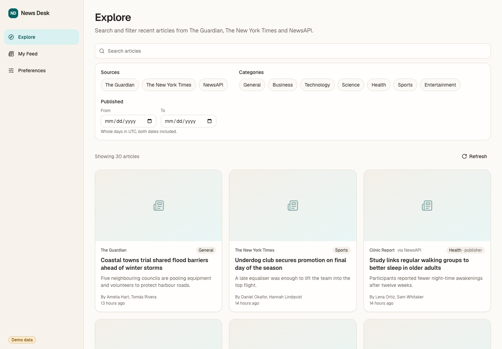
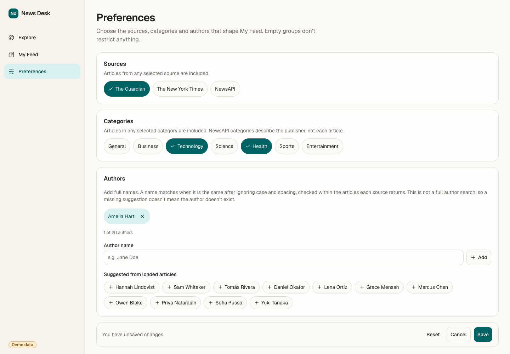
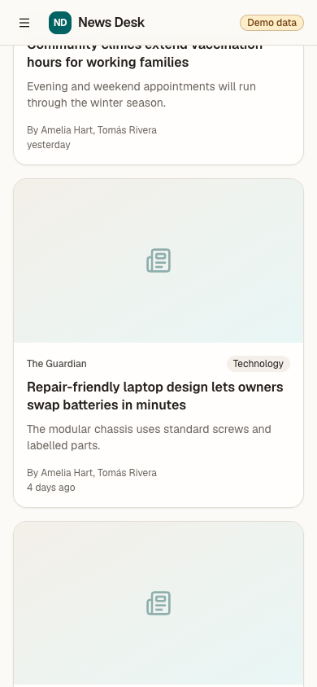

# News Desk

A React + TypeScript news aggregator that merges articles from **The Guardian**, **The New York Times** and **NewsAPI** into one responsive reading interface.

**Live app: https://innoscripta-news-aggregator-chi.vercel.app** (Live mode with real provider data)

| Explore (Demo data)                                                                                                    | Preferences                                                                                                                          | My Feed (mobile)                                                                            |
| ---------------------------------------------------------------------------------------------------------------------- | ------------------------------------------------------------------------------------------------------------------------------------ | ------------------------------------------------------------------------------------------- |
|  |  |  |

Screenshots use the synthetic Demo data, which has no images; Live articles show provider images.

## Start here

A suggested path through the app, on the [Live app](https://innoscripta-news-aggregator-chi.vercel.app) or a [local run](#run-locally):

1. **Explore:** search for a keyword, then filter by source, category and date range (inclusive UTC days). Search applies after a short pause or immediately on Enter. Filters live in the URL, so reload, sharing and Back/Forward restore them.
2. **Load more:** scroll to the end of the results. The next batch follows the server's cursor, duplicates across providers are removed, and your reading position stays put. Notes explain partial failures, provider limits and the real end of results.
3. **Preferences:** select sources and categories, optionally add authors (typed as full names or picked from loaded articles), then **Save**. **Cancel** restores the saved preferences; **Reset** clears only the draft.
4. **My Feed:** shows articles matching the saved preferences: OR within a group, AND between groups, and an empty group means "any". With nothing saved, it asks you to choose preferences.
5. **Mobile:** below 1024px, **Filters** opens a sheet. Changes apply only on **Apply**; **Cancel** discards them.

To follow the same path in the source, see the [Code walkthrough](#code-walkthrough).

## Run locally

### Requirements

- **Node.js 22** (`.nvmrc`). The production build, Docker image, CI and Vercel all use Node 22.
- **pnpm 10.33.0** (pinned in `package.json` → `packageManager`; install with `npm install --global pnpm@10.33.0`)
- **Docker** with Compose v2.24+ (only for the container)

### Without keys (Demo)

A fresh checkout has no `.env`, so it runs in **Demo** mode: deterministic, fictional articles with `example.com` links, no API keys, no outbound requests and a permanent **Demo data** badge.

```bash
pnpm install --frozen-lockfile
pnpm dev
```

Open http://localhost:5173. `pnpm dev` runs Vite and the Express API (port 8080, or `PORT` from the shell or `.env`) together, and Vite proxies `/api` to the API.

To run the production build:

```bash
pnpm build
pnpm start      # client and API on http://localhost:8080
```

### Docker

```bash
docker compose up --build
```

- **Demo:** without `.env`, serves the app and API on http://localhost:8080.
- **Live:** create `.env` as below and run the same command.
- **Port in use:** `HOST_PORT=8081 docker compose up --build`. Inside the container the API always listens on 8080, so `PORT` in `.env` does not apply.

The multi-stage Node 22 image installs production dependencies only, runs as the non-root `node` user and includes a health check.

### Live mode

Copy `.env.example` to `.env` and fill in:

```dotenv
NEWS_MODE=live
GUARDIAN_API_KEY=...   # https://open-platform.theguardian.com/access/
NYT_API_KEY=...        # https://developer.nytimes.com/
NEWSAPI_API_KEY=...    # https://newsapi.org/register
```

- **Required keys:** all three. Without them, `/api/feed` returns `503 configuration_error`, and the app says so instead of falling back to Demo data.
- **Where keys live:** only on the server. They never use a `VITE_` prefix and never reach the browser, and `.env` is git- and Docker-ignored.
- **Loading with pnpm:** `pnpm dev` and `pnpm start` load `.env` when present, and variables exported in the shell override its values.
- **Loading with Docker Compose:** the container gets the image defaults plus `.env` through `env_file`; other shell exports are not forwarded. Compose fixes the internal `PORT` at 8080, and `HOST_PORT` only selects the published host port.
- **Checking the setup:** `GET /api/health` shows the mode and which keys are configured, without revealing them.

## Tests and quality

| Command                                    | What it runs                                                                |
| ------------------------------------------ | --------------------------------------------------------------------------- |
| `pnpm format:check` · `lint` · `typecheck` | Prettier, ESLint, TypeScript                                                |
| `pnpm test`                                | Vitest unit and integration tests (Testing Library, MSW, Supertest)         |
| `pnpm test:e2e`                            | Playwright with axe against the production Demo build, desktop and mobile   |
| `pnpm smoke:live`                          | Optional manual check of the real APIs. It needs keys and is not part of CI |

Playwright uses its own Chromium (`pnpm exec playwright install chromium`). To use an installed Chrome instead, run `PLAYWRIGHT_CHANNEL=chrome pnpm test:e2e`.

GitHub Actions runs the quality checks, E2E and a Docker smoke test on every pull request. A push to `main` deploys to Vercel only after all three pass.

## Architecture

A single package with three source roots:

```
src/client/   React app: features/articles (reusable feed), explore, preferences, my-feed
src/server/   Express BFF: config, provider adapters, Demo data, feed service, routes
src/shared/   Zod contracts and pure helpers used by both sides
api/          Vercel function entry exporting the same Express app
```

The browser calls only the BFF (`GET /api/health`, `GET /api/feed`). The BFF queries the three providers in parallel with a 5-second timeout each, normalizes and validates the articles, caches successful pages for 5 minutes and returns per-provider statuses with an opaque cursor. On the client, TanStack Query handles requests and pagination, and React context holds the saved preferences. See [docs/architecture.md](docs/architecture.md) for details.

### Code walkthrough

One Explore request at runtime:

```
Explore filters (URL) → useFeed → GET /api/feed → feed route → feed service
  → Guardian / NYT / NewsAPI adapters → normalized articles, statuses, cursor
  → mergeArticles → article cards
```

The table lists entry points worth opening, not the runtime order above; their imports lead to the smaller helpers.

| Entry point                                                                                                                                                      | Why open it                                                                                                                                                                                                                                           |
| ---------------------------------------------------------------------------------------------------------------------------------------------------------------- | ----------------------------------------------------------------------------------------------------------------------------------------------------------------------------------------------------------------------------------------------------- |
| [`explore/use-explore-filters.ts`](src/client/features/explore/use-explore-filters.ts), [`explore-url.ts`](src/client/features/explore/explore-url.ts)           | How applied filters live in the URL: lenient parsing, one canonical form, and history entries for Back/Forward. [`ExplorePage.tsx`](src/client/features/explore/ExplorePage.tsx) shows how search, desktop filters and the mobile sheet feed into it. |
| [`articles/use-feed.ts`](src/client/features/articles/use-feed.ts)                                                                                               | Client fetching and pagination: one TanStack infinite query per mode and filter set, where the server's `nextCursor` drives **Load more**.                                                                                                            |
| [`articles/merge-articles.ts`](src/client/features/articles/merge-articles.ts), [`ArticleFeed.tsx`](src/client/features/articles/ArticleFeed.tsx)                | How batches become one deduplicated, newest-first list, and how the feed renders loading, partial failures, notices and the end of results.                                                                                                           |
| [`server/feed/feed-route.ts`](src/server/feed/feed-route.ts), [`feed-service.ts`](src/server/feed/feed-service.ts)                                               | The BFF side: request validation and error responses, then the per-provider fan-out with timeouts, cursor checks, caching and the shared date and author post-filter.                                                                                 |
| [`server/providers/`](src/server/providers)                                                                                                                      | The adapter contract in [`types.ts`](src/server/providers/types.ts) and one adapter per provider. Read these for each API's category, date and paging mapping; Demo data plugs in through the same contract in [`server/demo/`](src/server/demo).     |
| [`shared/feed-filters.ts`](src/shared/feed-filters.ts), [`shared/feed.ts`](src/shared/feed.ts)                                                                   | Zod contracts used by both sides: the filter schema behind the URL, the API query and saved preferences, and the response schema the browser validates.                                                                                               |
| [`preferences/PreferencesProvider.tsx`](src/client/features/preferences/PreferencesProvider.tsx), [`MyFeedPage.tsx`](src/client/features/my-feed/MyFeedPage.tsx) | Saved preferences: read once from storage, written only on Save, then turned into feed filters for My Feed through the same `ArticleFeed`.                                                                                                            |

## Limitations

- **Free plans:** NYT allows about 5 requests per minute. NewsAPI's Developer plan searches about one month back, delays articles, and is licensed for development and testing only. A rate-limited provider is paused with a message rather than retried.
- **NewsAPI categories:** `/v2/everything` has no category filter, so categories come from 16 curated publishers and describe the **publisher**, not each article. BBC Sport articles come back as `bbc-news`, so a BBC article gets a category only when the request makes it unambiguous.
- **Author filtering:** matches full names, ignoring case and spacing, within the pages the providers return. It is not an archive-wide author search, so a batch can have no matches while more follow.
- **Saved preferences:** stored only in this browser's `localStorage` (`news-desk.preferences`). There are no accounts and no cross-tab sync. If storage is blocked, they work for the session and the app says _"Changes are not persisted on this device."_
- **Provider behaviour differs:** multi-word search and section and tag coverage vary by provider.

## Documentation

- [docs/implementation-status.md](docs/implementation-status.md): requirement coverage, dated verification evidence and remaining limitations
- [docs/architecture.md](docs/architecture.md): design decisions, trade-offs and the feed API contract
- [docs/design.md](docs/design.md): visual direction, tokens, layout and references
- [docs/ai-usage.md](docs/ai-usage.md): development roles and the review workflow
